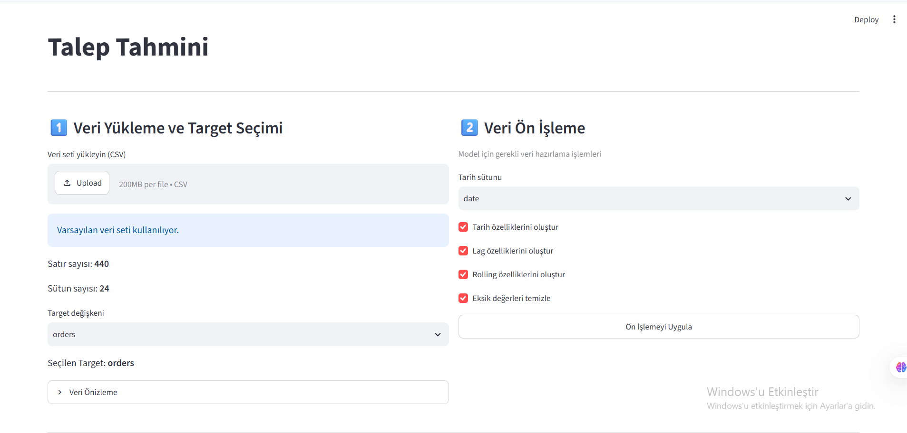
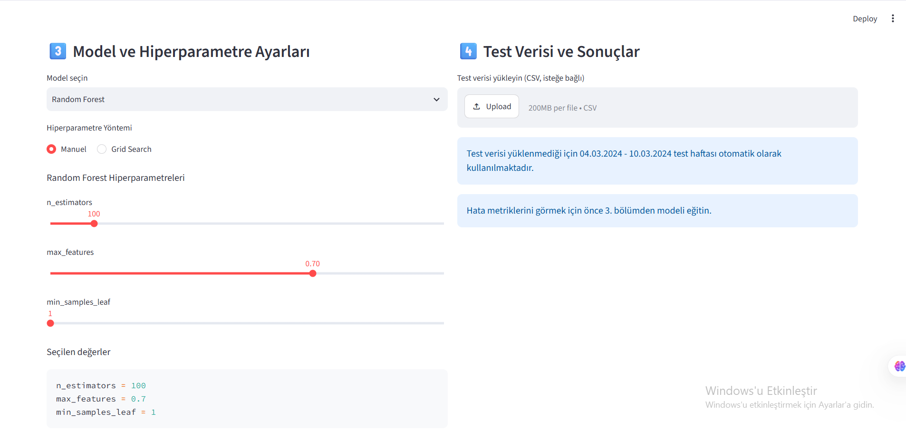

# Rohlik Talep Tahmini

Staj sırasında yaptığım bir proje. Rohlik'in Prague_3 deposundaki günlük sipariş sayısını tahmin etmeye çalışıyor. Arayüz için Streamlit kullandım, modeller Random Forest ve XGBoost.




## Ne yapıyor?

- CSV veri setini yüklüyorsun, tahmin edilecek sütunu (orders) seçiyorsun
- Tarih, lag (1, 7, 14 gün) ve rolling ortalama (7, 14 gün) özelliklerini otomatik oluşturuyor
- Random Forest veya XGBoost seçebiliyorsun
- Hiperparametreleri elle ayarlayabiliyorsun ya da Grid Search ile en iyisini buldurabiliyorsun
- Modeli 04.03.2024 - 10.03.2024 haftasında test ediyor, MAE, RMSE ve MAPE değerlerini gösteriyor
- İki modeli eğitince sonuçları tabloda yan yana karşılaştırabiliyorsun

Tahmin anında bilinemeyecek değişkenleri (yağış, kar, kullanıcı aktivitesi) modele koymadım, sadece takvim bilgileri ve geçmiş siparişler kullanılıyor.

## Kurulum

```bash
git clone https://github.com/melisacikbas/rohlik-demand-forecasting.git
cd rohlik-demand-forecasting
python -m pip install -r requirements.txt
```

## Çalıştırma

```bash
python -m streamlit run app.py
```

## Veri seti hakkında

Tam veri setini (prague3.csv) repoya koymadım. Denemek için `sample_data/sample_prague3.csv` dosyasını kullanabilirsin (01.09.2023 - 10.03.2024 arası, küçük bir kısmı). Uygulamada "Veri seti yükleyin" kısmından bu dosyayı seçmen yeterli. Veri daha az olduğu için sonuçlar tam veriyle aldığım sonuçlardan farklı çıkar.

Dosyada şu sütunlar olmalı: `date`, `orders`, `holiday`, `shops_closed`, `winter_school_holidays`.

## Kullanım

1. Veri setini yükle, target olarak `orders` seç
2. "Ön İşlemeyi Uygula" butonuna bas
3. Modeli ve yöntemi seçip "Modeli Eğit" butonuna bas
4. Sağ tarafta metrikleri ve tahmin grafiğini gör

## Kullanılan kütüphaneler

Python, Streamlit, pandas, NumPy, scikit-learn, XGBoost, joblib
